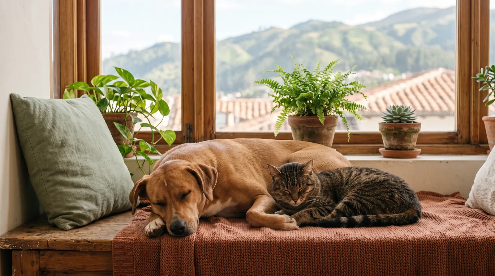
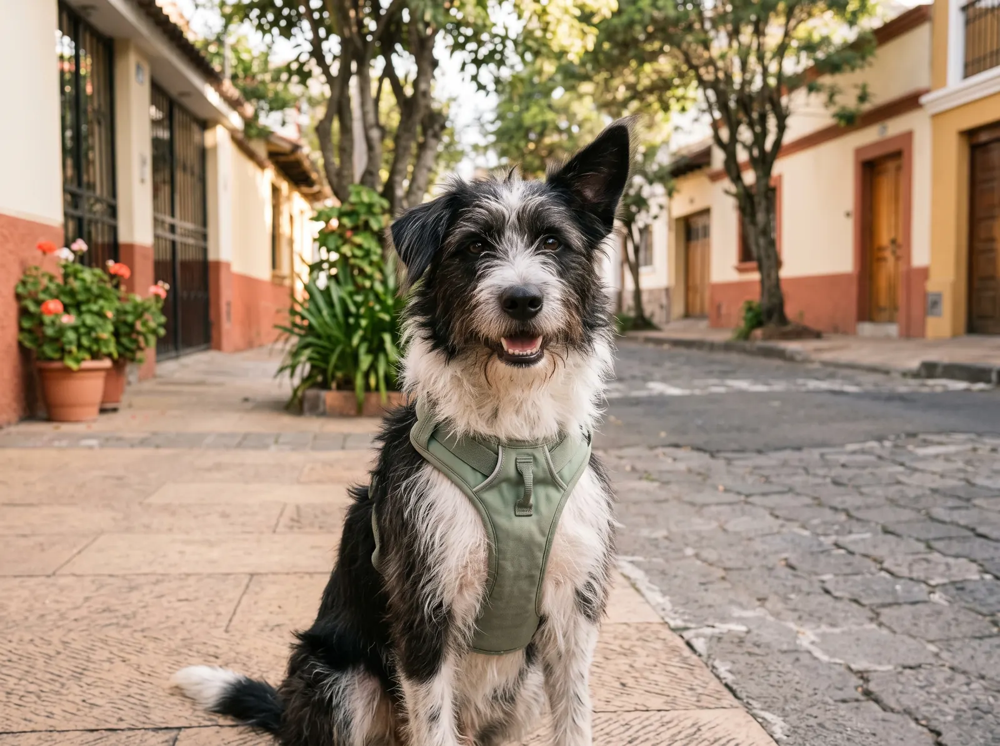
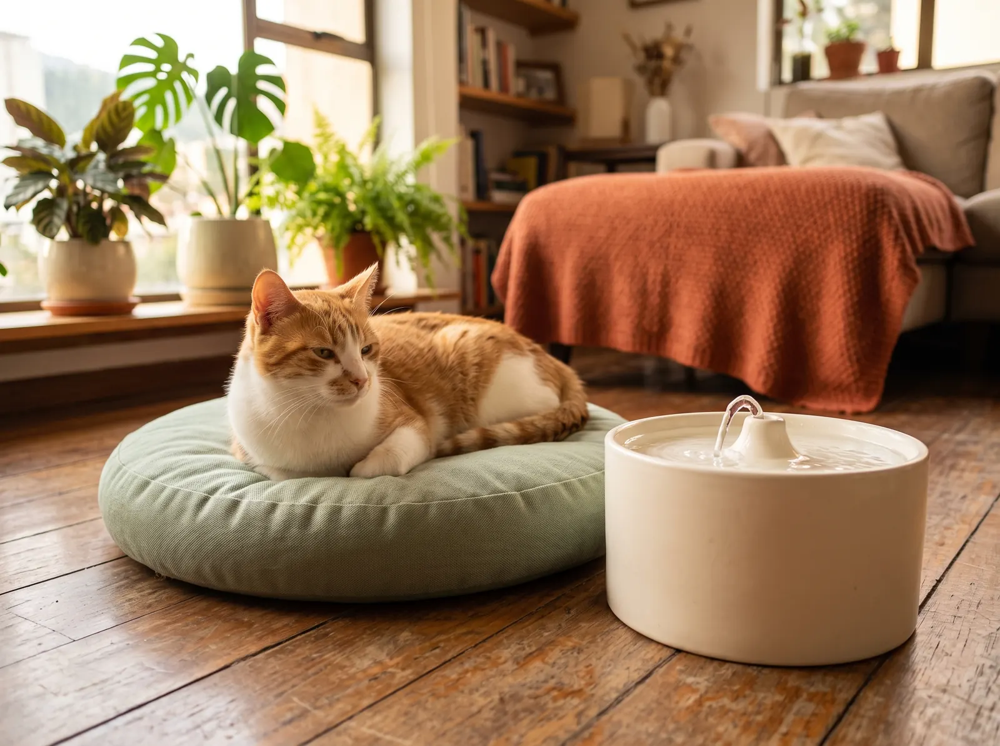
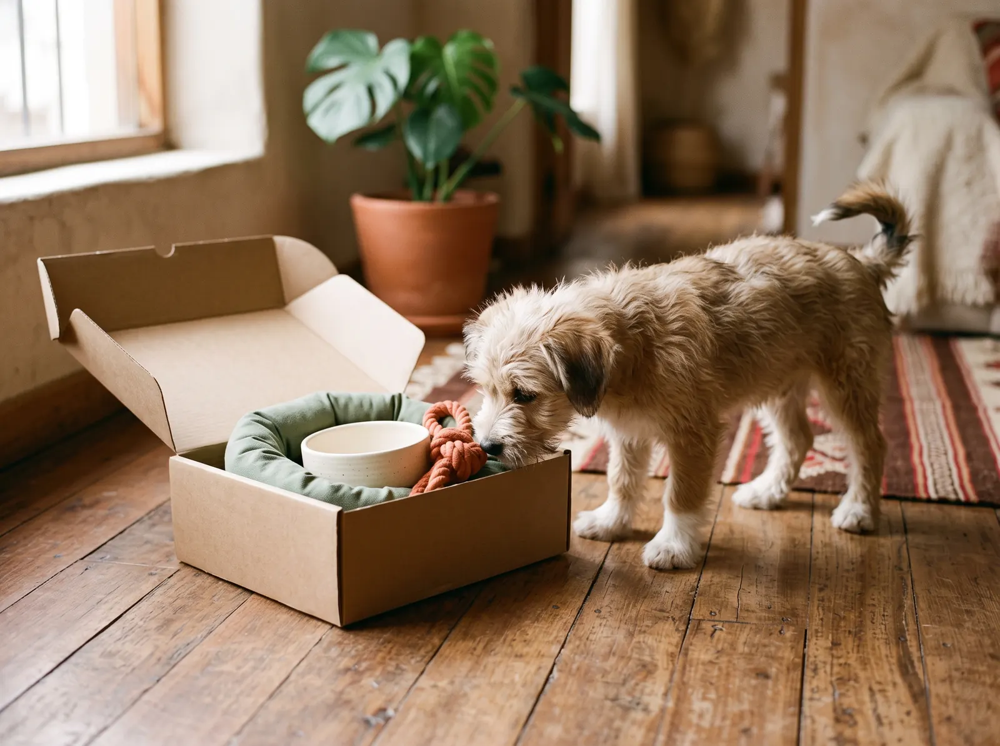
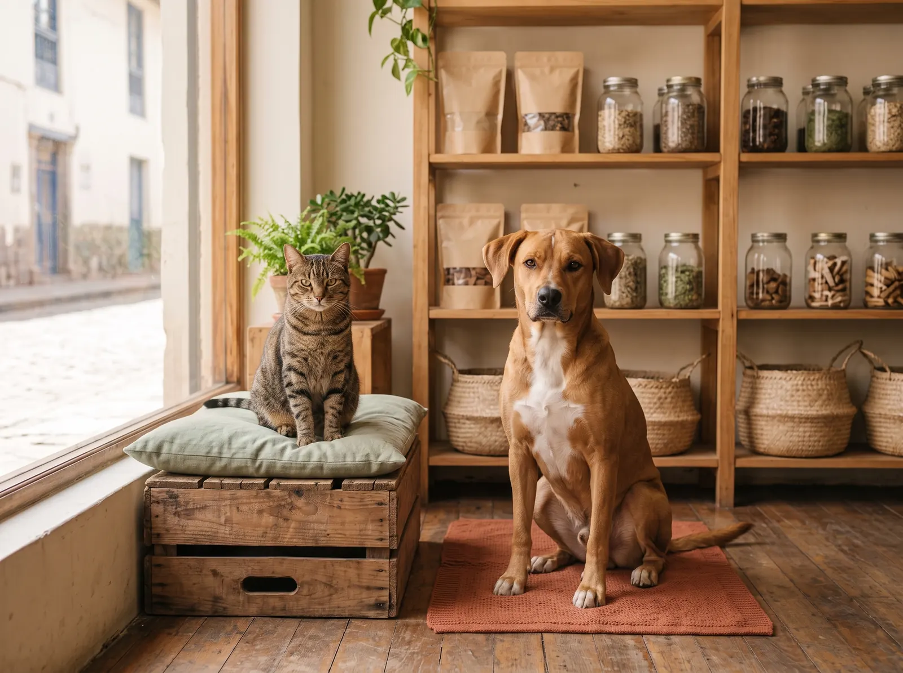
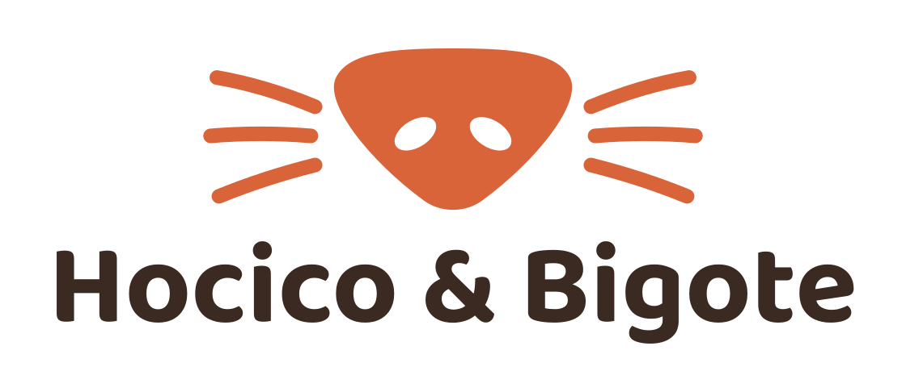

# Sitio web de Hocico y Bigote · respaldo en texto

Contenido de las 10 páginas de https://impulsoestrategicocx.com/demo/hocico-y-bigote/, como lo devuelve un crawler: por página, la URL relativa, el título, la descripción y el texto principal en Markdown. Igual que Website Content Crawler con su configuración por defecto, no incluye la navegación ni el pie de página (que repite el horario del local y el delivery, también presentes en el texto). Las imágenes aparecen con su texto alternativo.

---

## URL: ./

**Título:** Hocico y Bigote · Tienda de barrio para peludos y michis en Quito  
**Descripción:** Alimento, arena y accesorios para tu peludo y tu michi en La Floresta, Quito. Te explicamos sin vender humo y, si pides antes de las 14:00, te lo llevamos hoy.

Tienda de barrio en La Floresta, Quito

# La tienda de barrio de tu peludo y tu michi.

Alimento, arena y accesorios para perros y gatos. Te explicamos qué sirve y qué no, sin vender humo.

Y si pides antes de las 14:00, te lo llevamos hoy.

Ver los productos Conócenos

Delivery en el día en Quito si pides antes de las 14:00 · Gratis desde $35

## ¿Quién vive en tu casa?

Empieza por ahí. Cada peludo y cada michi necesita cosas distintas. Y casi nunca tantas como crees.

### Para peludos

Croquetas para perro adulto, un arnés que ayuda a que tire menos y una cama firme para los peludos mayores.

Ver lo de peludos

### Para michis

Croquetas para gato de departamento, latas, arena sin perfume, fuente de agua y un rascador alto. Para que deje tranquilo tu sofá.

Ver lo de michis

### Para recién llegados

Si acabas de adoptar, lo justo para la primera semana. Sin comprar de más y sin apuro.

Leer la lista honesta

## Lo que más se lleva el barrio

Cuatro básicos que nos piden una y otra vez. Cada uno con su línea honesta.

Alimento · Línea Barrio

### Croquetas de pollo y arroz para perro adulto

7,5 kg · $38,90

**Para quién es:** el peludo adulto que come de todo y necesita una base sencilla para todos los días.

**Lo honesto:** si tu peludo tiene alergias o una dieta indicada, esto no reemplaza lo que diga tu veterinario.

Arena e higiene · Línea Barrio

### Arena aglomerante sin perfume

10 kg · $14,50

**Para quién es:** el michi que no soporta los olores fuertes. O sea, casi todos.

**Lo honesto:** sin perfume también significa que hay que limpiar todos los días. Ninguna arena hace ese trabajo por ti.

Paseo e identificación

### Arnés acolchado antitirones

Tallas S a L · $24,90

**Para quién es:** el peludo que saca a pasear a su humano, y no al revés.

**Lo honesto:** ayuda a que tire menos, pero no lo educa solo. Eso se logra con paseos y paciencia.

Para recién llegados

### Kit de bienvenida

Para perro o para gato · $29,90

**Para quién es:** la familia que acaba de adoptar y no sabe por dónde empezar.

**Lo honesto:** si ya tienes plato y cama, no lo necesitas. Lleva solo lo que te falta.

Ver los doce productos

## Cómo trabajamos

Somos una tienda chica. Eso nos deja hacer las cosas a nuestra manera.

### Te decimos cuándo no comprar

Si algo no le hace falta a tu peludo o a tu michi, te lo decimos. Aunque perdamos la venta.

### Ingredientes en palabras simples

Te contamos qué tiene cada alimento como se lo contarías a tu familia. Sin siglas y sin promesas.

### La salud, con tu veterinario

Te ayudamos a elegir, pero no diagnosticamos ni recetamos. Eso lo ve tu veterinario, no una tienda.

### Somos del barrio

Te lo llevamos hoy dentro de Quito. Y si vives cerca, te esperamos en el local.

Club Hocico

## Cada diez compras, una bolsa de premios de regalo

Y en el cumpleaños de tu peludo o tu michi, un descuento para celebrar.

Si eres el peludo de la casa, recuérdaselo a tu humano.

**Para sumarte, pregúntanos en el local.**

El primer sábado de cada mes

## Feria de adopción en el local

Llegan peludos y michis que buscan familia, de la mano de refugios aliados.

Ven a conocerlos sin apuro. Adoptar es una decisión de toda tu familia.

**Te esperamos el primer sábado.**

## Pásate a olfatear sin compromiso

Estamos en La Floresta, de lunes a sábado de 9:00 a 19:00 y el domingo de 10:00 a 14:00.

Si no puedes venir, escríbenos a pedidos@hocicoybigote.example. Pídelo antes de las 14:00 y te lo llevamos hoy.

Nos vemos en el barrio. 🐾

---

## URL: productos/

**Título:** Productos · Hocico y Bigote  
**Descripción:** Doce productos para peludos y michis, cada uno con para quién es, qué tiene y lo honesto. Alimento, arena, juego, descanso y paseo, con delivery en Quito.

Productos

# Pocas cosas, bien elegidas.

Aquí no hay pasillos infinitos. Hay doce productos que usamos, conocemos y sabemos explicar.

Elegimos lo que de verdad hace mover la cola. Lo que solo se ve bonito en la foto se queda afuera.

**Cómo leer cada ficha**

- **Para quién es:** el peludo o el michi al que le sirve.
- **Qué tiene:** lo que trae, en palabras simples.
- **Lo honesto:** lo que te diríamos en el mostrador, aunque no compres.

Precios en dólares. Delivery en el día en Quito si pides antes de las 14:00 · Gratis desde $35.

## Alimento

Croquetas y latas de Línea Barrio, nuestra línea propia. Te contamos qué tienen sin siglas.

Alimento · Línea Barrio

### Croquetas de pollo y arroz para perro adulto

7,5 kg · $38,90

**Para quién es:** el peludo adulto que come de todo y necesita una base sencilla para todos los días.

**Qué tiene:** pollo y arroz como base, con las vitaminas y los minerales de un alimento completo. La tabla de porciones viene en la bolsa.

**Lo honesto:** si tu peludo tiene alergias o una dieta indicada, esto no reemplaza lo que diga tu veterinario.

Alimento · Línea Barrio

### Alimento húmedo para gato

Lata de 85 g · $1,60 · Caja de 12 · $17,90

**Para quién es:** el michi al que le gusta variar, o al que quieres darle algo húmedo junto a sus croquetas.

**Qué tiene:** trocitos en salsa, en una lata que alcanza para una comida. Si sobra, va tapada al refrigerador.

**Lo honesto:** la caja de 12 sale más barata, pero prueba primero con una lata. Hay michis que dicen que no, y no hay nada que hacer.

Alimento · Línea Barrio

### Croquetas para gato de departamento

3 kg · $24,50

**Para quién es:** el michi que vive puertas adentro, se mueve poco y duerme mucho.

**Qué tiene:** croqueta pequeña, con las vitaminas y los minerales de un alimento completo. La tabla de porciones está pensada para un michi que gasta poca energía.

**Lo honesto:** el nombre no hace magia. Si tu michi está subiendo de peso, lo que manda es la porción. Y el peso lo revisa tu veterinario.

## Arena e higiene

Lo de todos los días, también de Línea Barrio. Sin perfumes fuertes: su olfato es mucho más fino que el nuestro.

Arena e higiene · Línea Barrio

### Arena aglomerante sin perfume

10 kg · $14,50

**Para quién es:** el michi que no soporta los olores fuertes. O sea, casi todos.

**Qué tiene:** arena de arcilla que forma bolitas firmes con el pipí, para sacar solo lo usado. Sin perfume y con poco polvo.

**Lo honesto:** sin perfume también significa que hay que limpiar todos los días. Ninguna arena hace ese trabajo por ti.

Arena e higiene · Línea Barrio

### Shampoo suave de avena

$9,80

**Para quién es:** el peludo que vuelve del parque con medio parque encima.

**Qué tiene:** una fórmula suave con avena y sin perfume fuerte. Hace espuma con poca agua y se enjuaga fácil.

**Lo honesto:** bañarlo más seguido no es mejor. Con un baño al mes suele bastar. Si se rasca mucho o tiene la piel irritada, eso lo ve tu veterinario, no una tienda.

## Juego y descanso

Para que se cansen bien y duerman mejor. Y para que tu casa siga entera.

Juego y descanso

### Rascador torre de 80 cm

$49,00

**Para quién es:** el michi que ya eligió el sofá como rascador. Todavía estás a tiempo de proponerle otro.

**Qué tiene:** un poste forrado en cuerda, una plataforma arriba para mirar por la ventana y una base pesada para que no se tambalee.

**Lo honesto:** si lo escondes en un rincón, no lo va a usar. Ponlo junto a la ventana o al lado del sofá que quieres salvar.

Juego y descanso

### Cama ortopédica para perro senior

$59,00

**Para quién es:** el peludo mayor al que ya le cuesta levantarse, o que busca el rincón más blando de la casa.

**Qué tiene:** espuma firme que no se hunde, un borde bajo para entrar sin saltar y funda lavable.

**Lo honesto:** es más cómoda, pero no cura dolores. Si notas que cojea o le cuesta moverse, eso lo ve tu veterinario, no una tienda.

Juego y descanso

### Juguete dispensador de premios

$12,50

**Para quién es:** el peludo o el michi que se aburre cuando su familia sale a trabajar.

**Qué tiene:** una pelota que suelta premios o croquetas mientras la empuja. Se abre en dos para llenarla y lavarla.

**Lo honesto:** entretiene un rato, no un día entero. No reemplaza el paseo ni el juego contigo.

Juego y descanso

### Fuente de agua para gatos de 2 L

$32,00

**Para quién es:** el michi que ignora su plato de agua y prefiere tomar de la llave.

**Qué tiene:** cerámica fácil de lavar, 2 litros de capacidad y un chorrito suave que mantiene el agua en movimiento. Se desarma para limpiarla.

**Lo honesto:** hay michis que la adoran y otros que la miran con desconfianza una semana. Y hay que lavarla cada pocos días, como cualquier plato.

## Paseo e identificación

Para salir tranquilos y volver siempre a casa.

Paseo e identificación

### Arnés acolchado antitirones

Tallas S a L · $24,90

**Para quién es:** el peludo que saca a pasear a su humano, y no al revés.

**Qué tiene:** acolchado en el pecho y enganche adelante, para que tire menos. Viene en tallas S, M y L, y te ayudamos a medir en el local.

**Lo honesto:** ayuda a que tire menos, pero no lo educa solo. Eso se logra con paseos y paciencia.

Paseo e identificación

### Placa grabada

$8,00

**Para quién es:** todo peludo y todo michi que sale de casa, aunque sea al balcón.

**Qué tiene:** una placa de metal con su nombre y un teléfono de contacto, grabados en el local. Se engancha al collar o al arnés.

**Lo honesto:** cuesta poco y es lo que más ayuda si un día se escapa. Revisa que el teléfono siga siendo el tuyo.

## Para recién llegados

Si acabas de adoptar, empieza por aquí. Y después, por nuestra lista de la primera semana.

Para recién llegados

### Kit de bienvenida

Para perro o para gato · $29,90

**Para quién es:** la familia que acaba de adoptar y no sabe por dónde empezar.

**Qué tiene:** una camita, un plato y un juguete, elegidos para perro o para gato. La lista de la primera semana está en nuestro blog.

**Lo honesto:** si ya tienes plato y cama, no lo necesitas. Lleva solo lo que te falta.

## ¿Dudas con una talla o un alimento?

Pásate por el local en La Floresta o escríbenos a pedidos@hocicoybigote.example. Si ya sabes lo que necesitas, pídelo antes de las 14:00 y te lo llevamos hoy.

No vendemos medicamentos. Eso lo ve tu veterinario, no una tienda.

Nos vemos en el barrio. 🐾

---

## URL: nosotros/

**Título:** Nosotros · Hocico y Bigote  
**Descripción:** Sofía y Andrés abrieron Hocico y Bigote en 2019, en un local de 30 m² en La Floresta, Quito, por Mora y Lenteja. Esta es la historia.

Nosotros

# Una tienda chica, por una perra y un gato.

Hocico y Bigote abrió en 2019 en La Floresta, en un local de 30 m². Lo abrimos Sofía y Andrés, pero la idea fue de Mora y Lenteja.

Mora llegó primero. Es una perra mestiza color canela que adoptamos en una feria, con miedo a todo y un hambre infinita.

Lenteja apareció después. Es un gato atigrado que entró por la ventana de la cocina un día de lluvia, eligió a sus humanos y nunca más se fue.

Con ellos aprendimos lo difícil que es comprar bien. Nos vendían cosas que no hacían falta. Nadie nos explicaba qué tenía cada alimento.

Así que abrimos la tienda que nos habría gustado encontrar: chica, de barrio y honesta.

## Por qué ese nombre

Mora puso el hocico y Lenteja, los bigotes. El nombre se armó solo.

Los dos siguen viniendo al local. Mora recibe a todo el que entra. Lenteja supervisa desde el estante de arriba.

## Lo que creemos

- **Primero explicamos, después vendemos.** Queremos que salgas sabiendo qué necesita tu peludo o tu michi, aunque no lleves nada.
- **Te decimos cuándo no comprar.** Si algo no le hace falta, te lo decimos de frente.
- **Ingredientes en palabras simples.** Como se los explicaríamos a nuestra propia familia.
- **La salud, con tu veterinario.** Nosotros te ayudamos a elegir. Diagnosticar y recetar, eso lo ve tu veterinario, no una tienda.
- **Cada peludo y cada michi merece una familia.** Por eso, el primer sábado de cada mes, el local se vuelve feria de adopción con refugios aliados.

## En las fotos, solo ellos

En nuestras fotos salen Mora, Lenteja y los peludos y michis del barrio. Nosotros preferimos quedarnos detrás de la cámara.

## Ven a conocerlos

Pásate por el local en La Floresta con tu familia, peludos y michis incluidos. Mora te recibe en la puerta. Lenteja también, si está de humor.

Nos vemos en el barrio. 🐾

---

## URL: preguntas-frecuentes/

**Título:** Preguntas frecuentes · Hocico y Bigote  
**Descripción:** Delivery, horario de corte, devoluciones, medicamentos, asesoría, Club Hocico, feria de adopción y formas de pago. Respuestas cortas y claras.

Preguntas frecuentes

# Lo que más nos preguntan.

Respuestas cortas y sin pelos en la lengua. Si tu duda no está aquí, escríbenos a pedidos@hocicoybigote.example.

## ¿Hacen delivery?

Sí, dentro de Quito. Si pides antes de las 14:00, te lo llevamos hoy.

El delivery es gratis desde $35. Bajo ese monto tiene un costo, y te lo confirmamos antes de despachar.

Para pedir, escríbenos a pedidos@hocicoybigote.example con lo que necesitas y tu barrio.

## ¿Hasta qué hora puedo pedir para que llegue hoy?

Hasta las 14:00. Lo que pides antes, llega hoy. Lo que pides después, lo coordinamos contigo por correo.

Si prefieres venir, el local abre de lunes a sábado de 9:00 a 19:00, y el domingo de 10:00 a 14:00.

## ¿Puedo devolver un producto?

Sí, si está cerrado y sin usar. Tráelo al local o escríbenos y vemos cómo hacerlo.

Si algo llegó dañado o no es lo que pediste, te lo cambiamos sin costo.

El alimento abierto no se devuelve, por higiene. Por eso, si tu michi es de gustos difíciles, prueba con una lata antes de llevar la caja.

## ¿Venden medicamentos?

No. Ningún tipo de medicamento, ni con receta ni sin receta.

Si tu peludo o tu michi necesita uno, eso lo ve tu veterinario, no una tienda.

## ¿Me pueden asesorar?

Sí, y nos encanta. Te ayudamos a elegir alimento, arena, cama o arnés según su edad, su tamaño y cómo vive.

Pero no reemplazamos al veterinario. Alergias, peso, dietas especiales o cualquier síntoma: eso lo ve tu veterinario, no una tienda.

## ¿Qué es el Club Hocico?

Es nuestra forma de agradecerte que vuelvas. Cada diez compras, te regalamos una bolsa de premios.

Y en el cumpleaños de tu peludo o tu michi, tienes un descuento. Para sumarte, pregúntanos en el local.

## ¿Cómo funciona la feria de adopción?

El primer sábado de cada mes, el local recibe a refugios aliados con peludos y michis que buscan familia.

Puedes venir a conocerlos sin compromiso. Cada refugio te cuenta cómo es su proceso de adopción.

Adoptar es una decisión de toda tu familia. Tómate tu tiempo.

## ¿Cómo puedo pagar?

En el local, con efectivo, tarjeta o transferencia.

Para el delivery, con transferencia o en efectivo al recibir.

## ¿Te quedó otra duda?

Pásate por el local en La Floresta o escríbenos a pedidos@hocicoybigote.example. Te respondemos como vecinos.

Nos vemos en el barrio. 🐾

---

## URL: blog/

**Título:** Blog · Hocico y Bigote  
**Descripción:** Artículos cortos y prácticos para la vida con peludos y michis en Quito: porciones, aburrimiento, la primera semana después de adoptar y cambios de alimento.

Blog

# Para leer entre siesta y siesta.

Artículos cortos sobre la vida diaria con peludos y michis. Lo que sabemos, dicho en simple.

Y cuando el tema es de salud, te lo decimos de frente: eso lo ve tu veterinario, no una tienda.

Alimento · 3 minutos

## ¿Cuánto debe comer tu peludo? Sin fórmulas mágicas

La tabla de la bolsa es un punto de partida. Te contamos cómo ajustarla mirando a tu peludo, no al plato.

Leer el artículo

Michis · 3 minutos

## Michi de departamento: cinco señales de que se aburre (y qué hacer)

Te despierta de madrugada, empuja cosas de la mesa, ataca tus tobillos. No es maldad: es aburrimiento.

Leer el artículo

Recién llegados · 3 minutos

## Recién adoptaste: la lista honesta de lo que sí necesitas la primera semana (y lo que no)

Lo justo para que llegue tranquilo a casa. Y todo lo que puede esperar.

Leer el artículo

Alimento · 3 minutos

## Cambiar de alimento sin que su estómago lo sufra

Un plan de siete días para pasar de un alimento a otro. Sin apuro y sin sustos.

Leer el artículo

## ¿Quieres que escribamos sobre algo?

Cuéntanos en el local o escríbenos a pedidos@hocicoybigote.example. Casi todas nuestras ideas salen del mostrador.

Nos vemos en el barrio. 🐾

---

## URL: blog/cuanto-debe-comer-tu-peludo/

**Título:** ¿Cuánto debe comer tu peludo? Sin fórmulas mágicas · Blog de Hocico y Bigote  
**Descripción:** La tabla de la bolsa es un punto de partida, no una regla. Cómo ajustar la porción de tu peludo mirando su cuerpo, y cuándo preguntarle a tu veterinario.

Blog · Alimento

# ¿Cuánto debe comer tu peludo? Sin fórmulas mágicas

Es la pregunta que más escuchamos en el mostrador. La respuesta corta: depende de tu peludo. La larga está aquí.

## La tabla de la bolsa es un punto de partida

Toda bolsa de croquetas trae una tabla con gramos por peso. Sirve para empezar, no para quedarse ahí.

Esa tabla piensa en un perro promedio. Y tu peludo no es un promedio: tiene su edad, su energía y sus mañas.

Un peludo que corre toda la tarde en el parque no come lo mismo que uno que la pasa en el sofá.

## Ni a ojo ni a hocico: la porción se mide

El error más común es servir a ojo. Un puñado hoy, un puñado y medio mañana.

Usa una taza medidora o, mejor, una balanza de cocina. Pesa la porción del día y divídela en dos comidas.

Así sabes cuánto come de verdad. Y si algo cambia, lo notas a tiempo.

## Mira a tu peludo, no al plato

La mejor guía es su cuerpo. Pasa la mano por sus costillas: deberías sentirlas sin hacer fuerza, pero no verlas.

Mirado desde arriba, debería tener algo de cintura detrás de las costillas.

Si cuesta encontrar las costillas, puede que esté comiendo de más. Si se ven a simple vista, puede que le falte.

Pésalo una vez al mes. Si es chico, súbete con él a la balanza del baño y resta tu peso. Anótalo: los cambios lentos son los que más se escapan.

## Los premios también cuentan

El pedacito de pan, la galleta del desayuno, el premio por sentarse. Todo suma.

Si le das premios seguido, descuenta un poco de su porción. Y si en tu familia cada uno le da el suyo, pónganse de acuerdo.

Cuidado con esa mirada de «no he comido en años». Es pura actuación.

## Cuándo preguntarle a tu veterinario

Si sube o baja de peso sin razón, o si de repente come mucho más o mucho menos, no lo resuelvas con la tabla.

Eso lo ve tu veterinario, no una tienda. Conoce a tu peludo y te puede dar la porción justa para él.

Lo mismo si tiene alguna condición, si es cachorro, si ya es mayor o si está esperando cachorros. En esas etapas la porción cambia, y conviene que la defina un profesional.

## Lo que sí podemos hacer por ti

¿No entiendes la tabla de tu bolsa? Pásate por el local con ella y la leemos juntos.

Y si se te acabaron las croquetas, pídelas antes de las 14:00 y te las llevamos hoy.

Volver al blog

Nos vemos en el barrio. 🐾

---

## URL: blog/michi-de-departamento-senales-de-aburrimiento/

**Título:** Michi de departamento: cinco señales de que se aburre (y qué hacer) · Blog de Hocico y Bigote  
**Descripción:** Un michi de departamento aburrido te lo hace saber. Cinco señales para reconocerlo y cambios simples para que tenga más que hacer en casa.

Blog · Michis

# Michi de departamento: cinco señales de que se aburre (y qué hacer)

Un michi que vive puertas adentro tiene casi todo lo que necesita. Le falta una cosa: algo que hacer. Y cuando se aburre, te lo hace saber.

## Cómo te lo hace saber

1. **Te despierta de madrugada.** Maúlla, camina sobre tu cara o juega a las cinco de la mañana. Tiene energía de sobra y tú eres su único plan.
2. **Empuja cosas de la mesa.** Las mira, te mira y las empuja. No es maldad: está probando qué pasa.
3. **Ataca tus tobillos.** Te espera detrás de la puerta y salta. Es su forma de cazar cuando no tiene otra cosa que cazar.
4. **Rasguña donde no debe.** El sofá, la alfombra, el marco de la puerta. Rascar es necesario: el problema es que no tiene dónde.
5. **Duerme más de lo normal o come por pasar el rato.** Algunos michis aburridos se apagan en vez de hacer lío.

Un michi aburrido mete los bigotes en todo. La buena noticia es que se arregla con poco.

Y si eres un michi leyendo esto por encima del hombro de tu humano: sí, hablamos de ti.

## Qué puedes hacer en casa

No necesitas una casa nueva. Necesitas darle trabajo.

- **Juega con él dos veces al día.** Diez minutos con una caña o una pelotita bastan. Que persiga, salte y termine atrapando algo.
- **Dale altura.** A los michis les gusta mirar desde arriba. Un rascador alto junto a la ventana es rascador, mirador y cama a la vez.
- **Haz que la comida cueste un poco.** Un juguete dispensador de premios lo pone a pensar mientras tu familia está fuera.
- **Rota los juguetes.** Guarda la mitad y cámbialos cada semana. Lo viejo vuelve a ser nuevo.
- **Abre una ventana al mundo, con malla.** Una ventana segura y algo que mirar le dan horas de entretenimiento.

¿Y un segundo michi para que se acompañen? Puede funcionar, pero es una decisión grande para toda tu familia. No la tomes solo por el aburrimiento.

## Cuándo no es aburrimiento

Si el cambio es brusco, no lo atribuyas al aburrimiento.

¿Deja de comer, se esconde, se lame hasta pelarse o hace sus cosas fuera de la arena? Eso lo ve tu veterinario, no una tienda.

Lo mismo si duerme muchísimo más que antes o si está decaído. Mejor revisar y quedarse tranquilos.

## Para empezar esta semana

En el local tenemos el rascador torre de 80 cm y el juguete dispensador de premios. Pásate a verlos: Lenteja ya probó los dos.

Y si prefieres no salir, pídelos antes de las 14:00 y te los llevamos hoy.

Volver al blog

Nos vemos en el barrio. 🐾

---

## URL: blog/recien-adoptaste-lista-primera-semana/

**Título:** Recién adoptaste: la lista honesta de lo que sí necesitas la primera semana (y lo que no) · Blog de Hocico y Bigote  
**Descripción:** Lo justo para que tu nuevo peludo o michi llegue tranquilo a casa, y todo lo que puede esperar. Una lista honesta para la primera semana.

Blog · Recién llegados

# Recién adoptaste: la lista honesta de lo que sí necesitas la primera semana (y lo que no)

Adoptar da ganas de comprar la tienda entera. No hace falta. La primera semana se trata de que llegue tranquilo, no de que tenga de todo.

## Lo que sí necesitas

- **El mismo alimento que comía antes.** Pregunta en el refugio cuál era y compra ese, aunque después quieras cambiarlo. Los cambios, más adelante y de a poco.
- **Dos platos.** Uno para el agua y otro para la comida. Firmes y fáciles de lavar.
- **Un lugar suyo.** Una cama o una manta en un rincón tranquilo, lejos del paso. Ahí va a ir cuando quiera estar solo.
- **Identificación desde el primer día.** Una placa con su nombre y tu teléfono. Los primeros días son los de más riesgo de que se escape.
- **Para un peludo:** un arnés de su talla y una correa. **Para un michi:** arena sin perfume, su bandeja y un rascador.
- **Una transportadora, si es michi.** Para el viaje a casa y para ir al veterinario. No la vendemos, pero la vas a necesitar.
- **Una visita al veterinario.** En la primera semana, para conocerse, revisar sus vacunas y resolver tus dudas de salud. Eso lo ve tu veterinario, no una tienda.

## Lo que puede esperar

- **Ropa y disfraces.** A casi ningún peludo le gustan. Una buena manta abriga más.
- **Diez juguetes.** Con uno o dos basta para descubrir qué le gusta.
- **La cama más cara.** Primero mira dónde le gusta dormir. A veces elige el piso, al lado de tu cama.
- **Suplementos y vitaminas «por si acaso».** Si los necesita, te lo dirá tu veterinario.
- **Cambiar de alimento.** Ya tiene bastantes cambios encima esta semana.

## Lo que no se compra

Paciencia y rutina. Comidas a la misma hora, paseos a la misma hora y un lugar fijo para dormir.

Algunos llegan con miedo y tardan días en salir de debajo de la mesa. Es normal. Déjalo acercarse a su ritmo.

Y que toda tu familia esté de acuerdo con las reglas. Si uno lo sube al sofá y otro lo baja, se confunde.

La primera semana es más de olfato que de compras: deja que conozca la casa con calma.

## Si no tienes nada

El Kit de bienvenida ($29,90) trae una camita, un plato y un juguete, para perro o para gato.

Si ya tienes algo de eso, no lo lleves. Compra solo lo que te falta.

## Para empezar con calma

¿Recién adoptaste y tienes dudas? Pásate por el local, o ven a la feria de adopción del primer sábado de cada mes. Conversamos sin apuro.

Volver al blog

Nos vemos en el barrio. 🐾

---

## URL: blog/cambiar-de-alimento-sin-sustos/

**Título:** Cambiar de alimento sin que su estómago lo sufra · Blog de Hocico y Bigote  
**Descripción:** Un plan de siete días para cambiar el alimento de tu peludo o tu michi de a poco, qué mirar esos días y cuándo preguntarle a tu veterinario.

Blog · Alimento

# Cambiar de alimento sin que su estómago lo sufra

Cambiar de alimento de un día para otro es la receta para una semana difícil. Hecho de a poco, casi siempre pasa sin que nadie lo note.

## Primero: ¿hace falta cambiar?

Si tu peludo o tu michi come bien, tiene energía y está en su peso, no hay apuro. Cambiar por cambiar no le suma nada.

Hay buenas razones para hacerlo: que pase de cachorro a adulto o de adulto a mayor, o que te lo indique tu veterinario.

Cambiar por precio o por comodidad también vale. Solo hazlo con calma.

## El plan de siete días

Su estómago está acostumbrado a lo que come todos los días. Un cambio brusco lo toma por sorpresa.

La idea es mezclar el alimento de siempre con el nuevo y subir la parte nueva de a poco.

- **Días 1 y 2:** tres partes del alimento de siempre y una del nuevo.
- **Días 3 y 4:** mitad y mitad.
- **Días 5 y 6:** una parte del de siempre y tres del nuevo.
- **Día 7:** solo el nuevo.

Mezcla bien, para que no aparte las croquetas nuevas. La porción del día es la misma: lo que cambia es la mezcla, no la cantidad.

Pega el plan en el refrigerador: así toda tu familia sabe en qué día van.

## Para que el cambio no le caiga pesado

Esos días, mira lo que deja en el paseo o en la arena. Un poco más blando al principio puede pasar.

Si pasa, no avances. Quédate dos o tres días más en el mismo paso antes de seguir.

Con los michis, ve todavía más lento. Hay michis que necesitan dos semanas en vez de una, y está bien.

## Lo que conviene evitar esos días

- **Estrenar premios.** Si algo le cae mal, no vas a saber qué fue.
- **Cambiar también los horarios.** Con un cambio por vez es suficiente.
- **Saltarse pasos porque «ya se acostumbró».** El estómago va más lento que el entusiasmo.

## Cuándo parar

Si tiene diarrea más de un día, vomita o deja de comer, vuelve al alimento de siempre y consulta. Eso lo ve tu veterinario, no una tienda.

Con un michi que deja de comer, no esperes: llama a tu veterinario ese mismo día.

Y si tiene alguna condición o una dieta indicada, el cambio lo decide tu veterinario.

## Para empezar mañana

¿Vas a pasarte a las croquetas de Línea Barrio? Pídelas antes de las 14:00, te las llevamos hoy y mañana empiezas con el día 1.

Si prefieres armar el plan con alguien, pásate por el local y lo hacemos juntos.

Volver al blog

Nos vemos en el barrio. 🐾

---

## URL: prensa/

**Título:** Prensa y aliados · Hocico y Bigote  
**Descripción:** Quiénes somos, la paleta con sus códigos, las tipografías, cómo usamos las fotos y el logo de Hocico y Bigote para descargar.

Prensa

# Prensa y aliados

Todo lo que necesitas para mostrarnos bien, de hocico a bigote.

## Quiénes somos

Hocico y Bigote es una tienda de barrio de alimentos y accesorios para perros y gatos en La Floresta, Quito.

La abrieron Sofía y Andrés en 2019, en un local de 30 m², por Mora y Lenteja.

Hacemos delivery en el día en Quito y, el primer sábado de cada mes, una feria de adopción con refugios aliados.

## El logo

El isotipo es una nariz de perro con tres bigotes a cada lado, en terracota. El logotipo dice «Hocico & Bigote», en Baloo 2 y color café.

Cuando nos nombres en un texto, escribe «Hocico y Bigote», con «y».

Úsalo sobre fondos claros, crema o blanco. No lo estires, no le cambies los colores y no le agregues sombras.

- Logo en SVG · Vectorial, para imprimir o escalar sin perder calidad.
- Logo en PNG · 1024 × 1024 px, con fondo transparente.
- Logo horizontal en PNG · 1600 × 500 px, con fondo transparente.

## La paleta

Cinco colores cálidos, sacados de una casa de barrio: ladrillo, plantas, pared, madera y un poco de sol.

### Terracota

#D9643A

RGB 217, 100, 58

El principal: logo, botones y lo que tiene que verse.

### Salvia

#8FAE8B

RGB 143, 174, 139

El secundario: fondos de sección, mantas y cojines.

### Crema

#FFF6EC

RGB 255, 246, 236

El fondo de todo. Cálido, nunca blanco puro.

### Café

#3A2A22

RGB 58, 42, 34

El texto y el logotipo.

### Mostaza

#E8B04A

RGB 232, 176, 74

El acento. Poco, como la sal.

## Las tipografías

### Baloo 2

En negrita (700), para títulos y para el logotipo. Redonda y amable, como el barrio.

### Nunito

En regular (400) y negrita (700), para el texto. Se lee fácil en el teléfono.

Las dos son gratuitas y están en Google Fonts.

## Cómo usamos las fotos

Nuestras fotos se parecen a la casa de cualquier familia de Quito, no a un catálogo.

### Sí

- Luz natural y cálida.
- Casas reales de Quito: ventanas, plantas y madera.
- Perros y gatos mestizos, como los que llegan a la feria.
- Mantas y cojines terracota, salvia y crema.
- Solo animales: las personas no salen en nuestras fotos.

### Nunca

- Fondos blancos de estudio.
- Razas de catálogo posando.
- Filtros fríos.
- Animales disfrazados.
- Texto sobre la cara del animal.

## Fotos de referencia

Tres fotos para entender el tono. Puedes usarlas para hablar de nosotros.

La siesta de Mora y Lenteja, junto a la ventana. JPG de 1600 px: descargar.

Un michi de departamento, su cojín y su fuente. JPG de 1600 px: descargar.

Un recién llegado conociendo su caja de bienvenida. JPG de 1600 px: descargar.

## ¿Vas a escribir sobre nosotros?

Escríbenos a pedidos@hocicoybigote.example o pásate por el local en La Floresta. Si tienes un refugio y quieres sumarte a la feria del primer sábado, también.

Nos vemos en el barrio. 🐾
